# **GOITSEMANG PATIENCE MAROKOANE**

UX/UI DESIGNER \| WEB DEVELOPER \| ICT STUDENT

📞 064 657 6303 | 📧 240291573@mycput.ac.za | 📍 Cape Town, South Africa  

I am an aspiring UX/UI designer / Web developer specialising in intuitive 
digital experiences. I am constantly on a mission to learn and grow, and I 
enjoy creating minimal and impactful designs. I combine creativity, structure, 
and leadership to bring clarity and precision to every project. 

---

## **🌐 PORTFOLIO LINK**
[[Visit my Portfolio](https://gpm-digitalconcepts.netlify.app/)]

---

## **🎓 EDUCATION**

2019 – 2023 
**High Scool** 
Hoerskool Drie Riviere

2024 – Present 
**Diploma in ICT:Multimedia** 
Cape Peninsula University of Technology

---

## **💻 TECHNICAL SKILLS**

- HTML
- CSS
- Bootstrap
- JavaScript
- React
- Vue.js
- Node.js
- Basic version control - Git
- Java
- Python
- MySQL
- MongoDB 
- Figma
- Adobe Illustrator
- Adobe InDesign

---

## **🚀 PROJECTS**

### **Web Development**
- Developed a simple Vue.js web application for a coffee shop frontend.
- Built a hair braiding business website with frontend, backend, and database 
integration.
- Created a login and sign-up system linked to a shopping cart feature.
- Created a web application for AfterCare, a wellness centre for professionals, using React.

### **Brand Design**
- Designed logos for my personal brand and fictional brands. 
- Created brand guidelines, mock-ups, and visual identities. 
- Developed basic marketing strategies. 

### **UX/UI Design**
- Redesigned the myRunway mobile application. 
- Created wireframes, mock-ups, and interactive prototypes for a project 
focused on developing a technical solution to address unemployment.
- Built a design system for a startup business (AfterCare).

---
## **✅ REFERENCES**

**Meagan Hamman** 
Cape Peninsula University of Technology 
HammanM@cput.ac.za | 021 460 3752 
Lecturer at CPUT 
 
**Palesa Monyatsi** 
Braided by Sekae 
Pearlpalesa74@gmail.com | 081 756 0407 
Client 

---

## **🤝 VOLUNTEERING**

**University of the Western Cape** – Coached and supervised primary school youth 
players on Youth Day, designing fun drills and mini-games to encourage teamwork 
and skills development.

---

## **🎬 MOCK NTERVIEW**

<video width="400" controls>
  <source src="Mock-Interview(1).mp4" type="video/mp4">
  Your browser does not support the video tag.
</video> 

---

## **📝 WORK READINESS REFLECTION**

### **Coding in Markdown reflection:**  
**Situation:**   As part of the Work Readiness Training at Cape Peninsula University of Technology, we were assigned to code our CV's in GitHub using Markdown and also include our mock interview video. The purpose of using Markdown in this project was to learn how to create well-structured and readable web content using a simple text-based formatting language. It is commonly used by developers on platforms like GitHub to document projects, create portfolios, and organize information clearly.  

**Task:**   Learn how to use Markdown syntax to create and structure my digital portfolio. This included formatting headings, adding links, embedding media, and organizing information in a clear and readable way.  

**Action:**   I started by researching Markdown syntax and how it works. I started by coding my CV using the different syntax characters and formats. I then structured my portfolio so that sections such as my CV, mock interview video, and reflections were clearly organized and easy to read.  

**Result:**   I learned how to use Markdown and I developed a better understanding of how developers document and present their work online. Learning Markdown improved my ability to structure digital content effectively and helped me create a professional looking portfolio. The process was enjoyable and quick as it is similar to html, just much more simpler.

### **Mock Interview video experience reflection:**  
**Situation:**   As part of the Work Readiness Training at Cape Peninsula University of Technology, we were assigned to record a mock interview video designed to simulate a real professional job interview. The purpose of this activity was to help students practice presenting themselves to potential employers and to prepare us for real workplace interactions.  

**Task:**   Record a mock interview video and present myself professionally. I had to answer interview questions using the STAR method and explain my technical skills and projects. The goal was to practice communicating my abilities clearly while demonstrating confidence and professionalism.  

**Action:**   To prepare, I went through the list of interview questions we were provided with, researched the different types of questions, and then picked one question from each section. I then wrote down my questions and responses and practiced using the STAR method. I went through the guidelines clearly and during the interview I focused on speaking clearly, maintaining professionalism and eye-contact, and providing thoughtful responses. After a few attempts I managed to get it right! Uploading the video was a bit difficult as the file size was over the limit so I had to reduce the resolution.  

**Result:**   The mock interview helped me gain confidence in presenting myself in a professional setting. It improved my communication skills and helped me understand how to effectively explain my skills and experiences during an interview. This experience has prepared me better for real job interviews in the future.

### **Using GitHub Pages reflection:**  
**Situation:**   As part of the Work Readiness Training at Cape Peninsula University of Technology, we were required to create a digital portfolio to showcase our work readiness activities. This included presenting our CV, mock interview video, and reflections using Markdown. To achieve this, we used GitHub Pages to publish and host our portfolio so that it could be accessed through a public web link.  

**Task:**   Deploy my portfolio using GitHub Pages so that it could be accessed through a public link. This required connecting my GitHub repository to GitHub Pages and ensuring that my Markdown content was displayed correctly as a website.  

**Action:**   I followed the instructions that were provided and created a GitHub repository, uploaded my CV files, and enabled GitHub Pages to publish the site. I then later added more content for my portfolio and ensured that it included my CV, mock interview video, and reflections, and that the content was properly formatted using Markdown.  

**Result:**   Publishing my portfolio on GitHub Pages was not difficult at all and it is a quick and straightforward process. It allowed me to create a professional online presence and share my work through a simple web link. This experience helped me understand how developers deploy and host content online, and it improved my skills in using GitHub as a professional development tool.

## **AGILE PROJECT CHARTER**

### **Evidence:**

  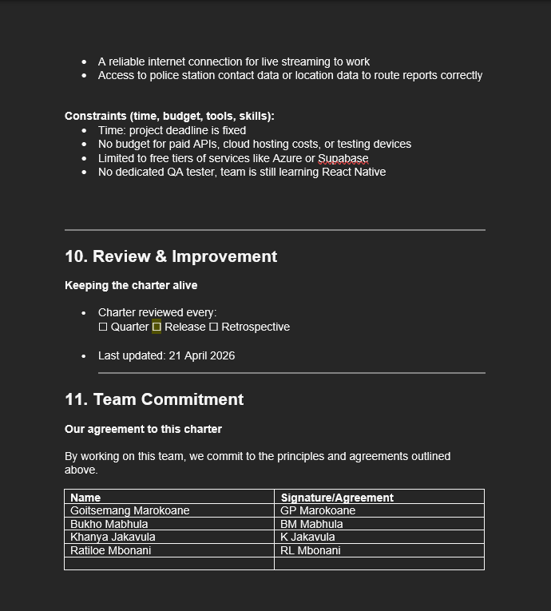
  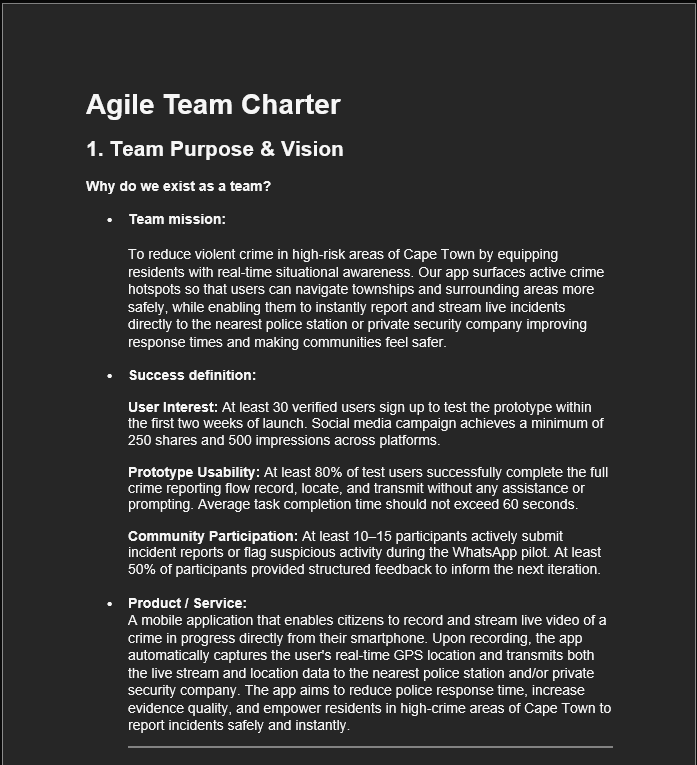
  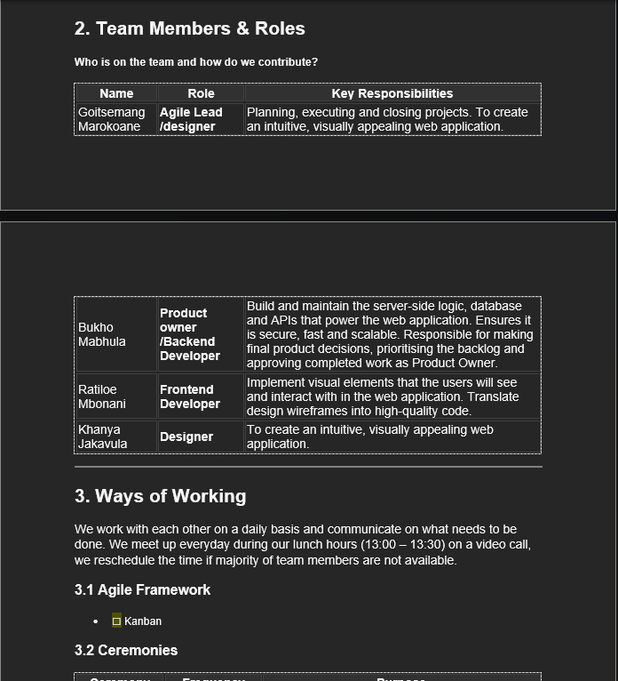

### **Reflection:**
**Situation:**   As part of the Project Presentation WIL project at Cape Peninsula University of Technology, we were required to work collaboratively as a team to plan and manage the development of our application using Agile project management. To establish a shared understanding of how we would work together, we created an Agile Team Charter.  

**Task:**   Contribute to defining the team's shared goals, responsibilities, values and working agreements.  

**Action:**   I participated in the process of establishing the team's working agreements and understanding the importance of having clearly defined roles and responsibilities. The charter provided a reference for how we would communicate, manage our responsibilities and work towards our shared project objectives.  

**Result:**    Creating the Agile Team Charter helped establish a common understanding of the team's expectations and responsibilities. It highlighted the importance of communication, accountability and collaboration in successful project management. I learned that a it can help reduce misunderstandings, manage conflict and keep team members aligned throughout the project.

## **USER STORIES AND TASKS**

### **Evidence:**

  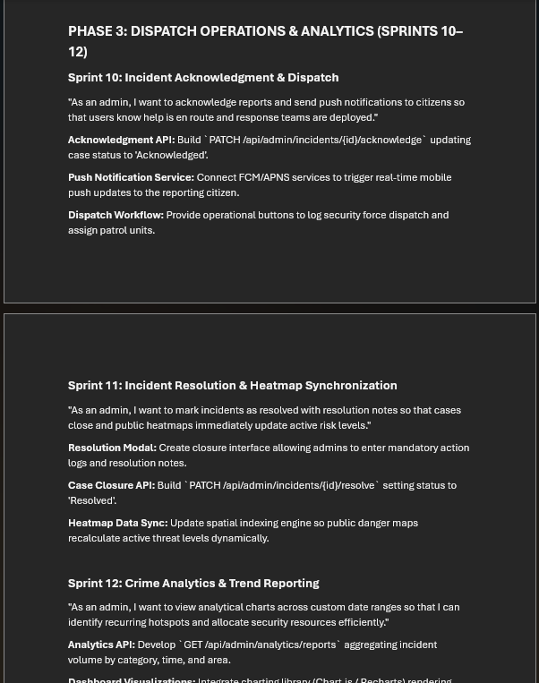
  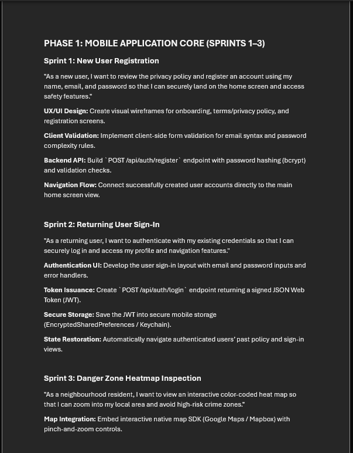
  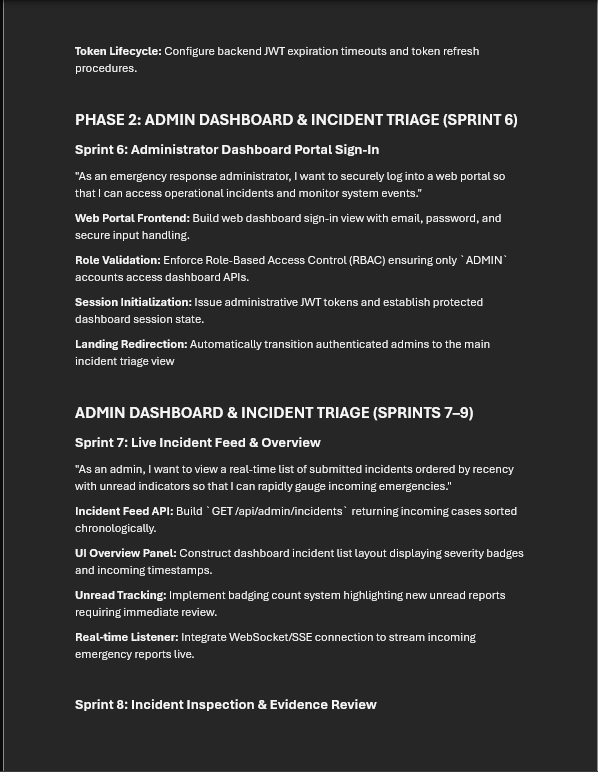

### **Reflection:**
**Situation:**   During the planning phase of our project, we needed to break down the application's requirements into manageable pieces of work. Agile user stories allowed us to describe the required functionality from the user's perspective and understand the value of each feature.  

**Task:**   Understand how user stories and tasks contribute to Agile planning. This involved identifying user needs, describing the expected functionality and breaking larger requirements into smaller tasks that could be assigned to team members.  

**Action:**   I worked with the user story and task breakdown to understand how project requirements could be organised into actionable work. I also considered how each story could be divided into smaller tasks to make the work easier to plan, allocate and track.  

**Result:**   This activity helped me understand how user stories connect the user's needs to the development team's work. Breaking stories into tasks makes project requirements more manageable and supports better estimation, prioritisation and progress tracking. I learned that clear user stories help ensure that the team focuses on delivering meaningful functionality rather than simply completing tasks without understanding them.

## **PRODUCT BACKLOG**

### **Evidence:**

  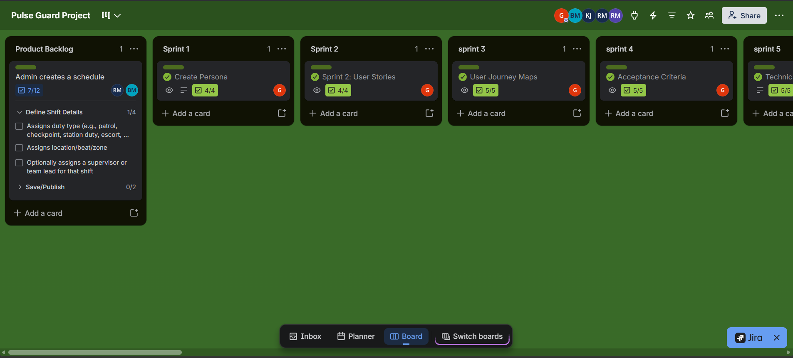

### **Reflection:**
**Situation:**   As part of our Agile project activities, we needed a practical way to organise tasks, monitor progress and coordinate the work assigned to different team members. Trello provided a visual Kanban-style board that could be used to manage the project's workflow.  

**Task:**   Understand how Trello could support our team's project planning and task management. This involved organising work into the product backlog, tracking the status of tasks and using the board to gain a clearer overview of the work that needed to be completed.  

**Action:**   I explored how Trello boards, lists and cards could be used to represent the project's workflow. Tasks could be organised according to their status, such as work to be done, work in progress and completed work. This approach demonstrated how team members could monitor progress, identify outstanding tasks and maintain visibility of project responsibilities.  

**Result:**   Using Trello helped me understand the value of visual project management tools in organising and tracking team activities. A Kanban board makes it easier to see what work remains, what is currently being completed and what has been finished.

## **SPRINT BACKLOG**

### **Evidence:**

  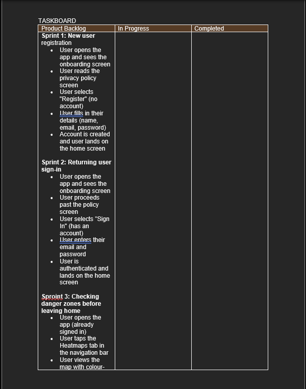
  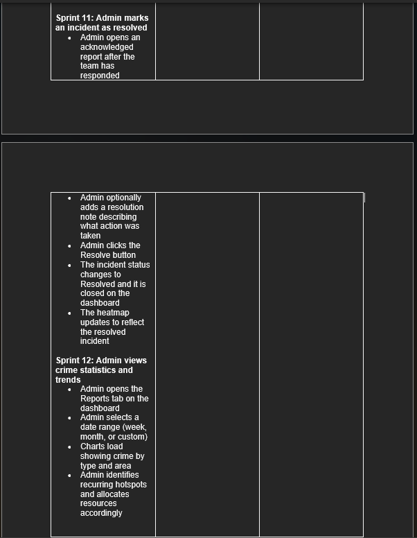
  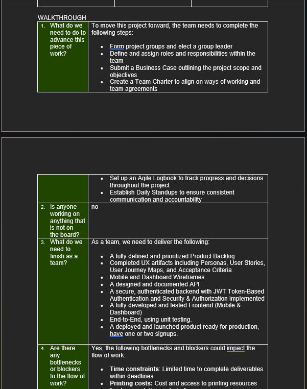

### **Reflection:**
**Situation:**   During the Agile planning process for our group project, we needed to organise the application's requirements and determine which tasks should be prioritised during each development iteration. The product backlog and sprint backlog provided a structured way to manage the overall project requirements and the work selected for a particular sprint.  

**Task:**   Understand the purpose of both backlogs and how they support sprint planning. This involved recognising the difference between the product backlog and the sprint backlog.  

**Action:**   I examined how requirements and features could be prioritised in the product backlog according to their importance and value. I also considered how selected backlog items could be broken down into actionable tasks for a sprint, with a clear sprint goal guiding the team's work.  

**Result:**   This activity helped me understand how backlogs support prioritisation, organisation and continuous progress in Agile projects. The product backlog provides an evolving overview of the work required, while the sprint backlog gives the team a more focused plan for the current iteration. I learned that maintaining clear and prioritised backlogs helps teams manage changing requirements, allocate work effectively and deliver progress progressively.

## **AGILE LOGBOOK**

### **Evidence:**

  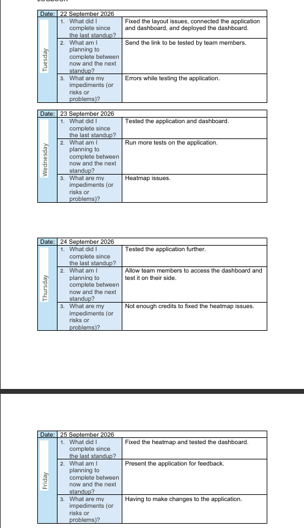
  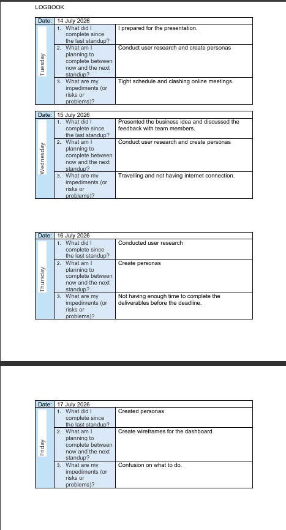
  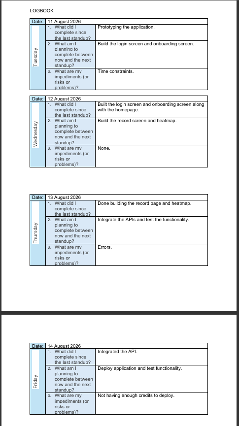

### **Reflection:**
**Situation:**   Throughout the project, tracking activities, recording progress and reflecting on the team's work were important for maintaining accountability and understanding how the project was progressing. An Agile logbook provided a way to document sprint planning, daily progress updates and retrospective discussions.  

**Task:**   Understand how an Agile logbook supports project monitoring and continuous improvement. This involved recognising the importance of recording completed work, outstanding tasks, challenges encountered and lessons learned during the development process.  

**Action:**   I explored how an Agile logbook could be used to document sprint goals, progress updates, team discussions and retrospective outcomes. These records help identify what has been accomplished, what still needs attention and whether any obstacles are affecting progress.  

**Result:**   The Agile logbook helped me understand the importance of maintaining consistent project records and reflecting on the team's progress. Recording activities creates a clearer history of decisions, and challenges and achievements. I learned that effective Agile project management involves not only planning and completing tasks but also reviewing progress, learning from challenges and adapting the team's approach, when necessary, it is an iterative process.
